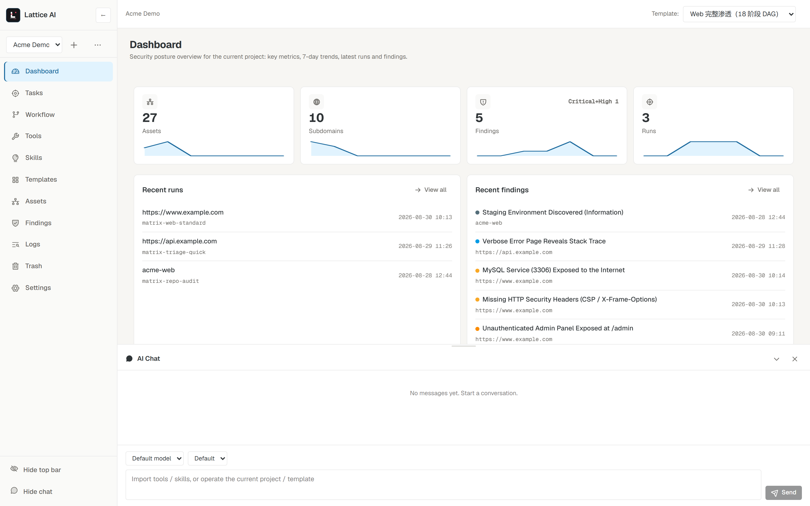
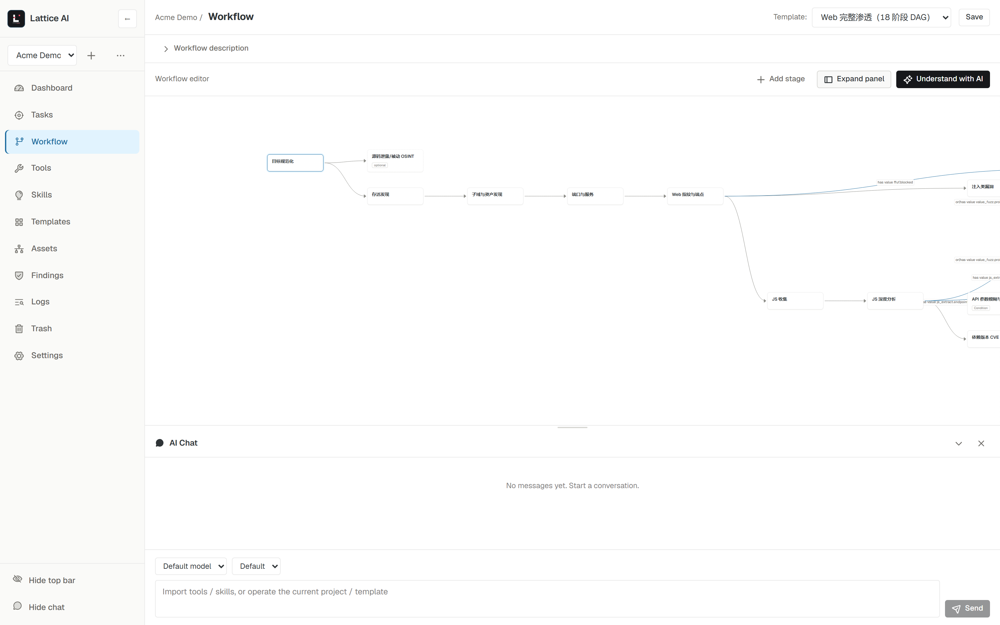
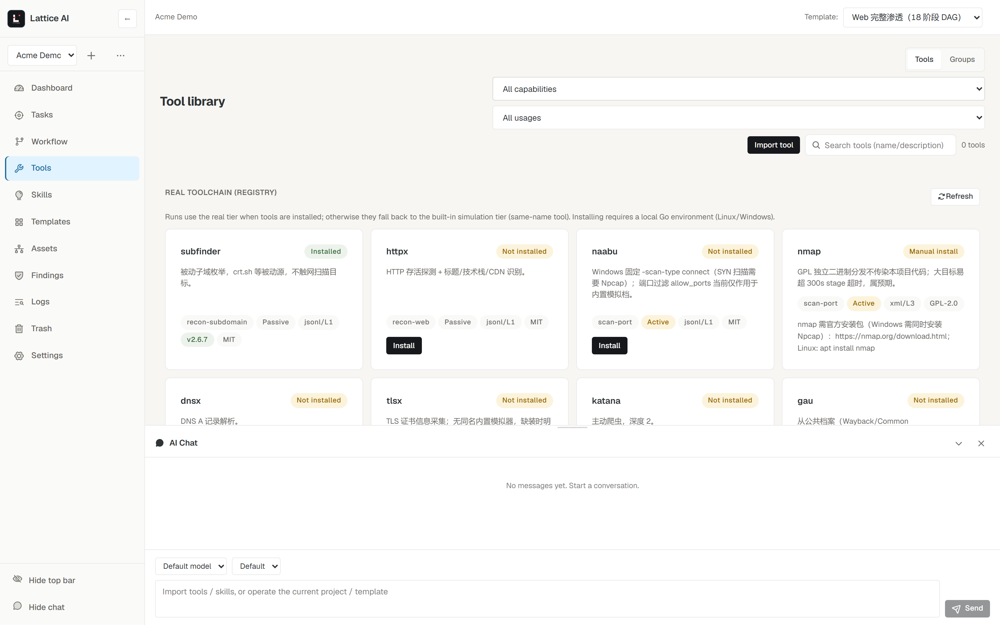
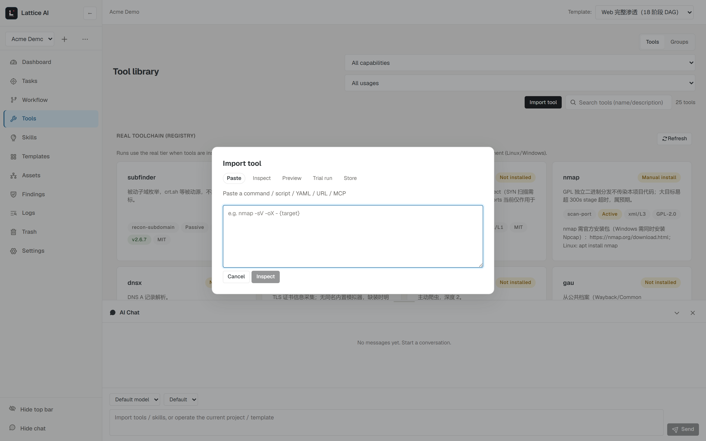
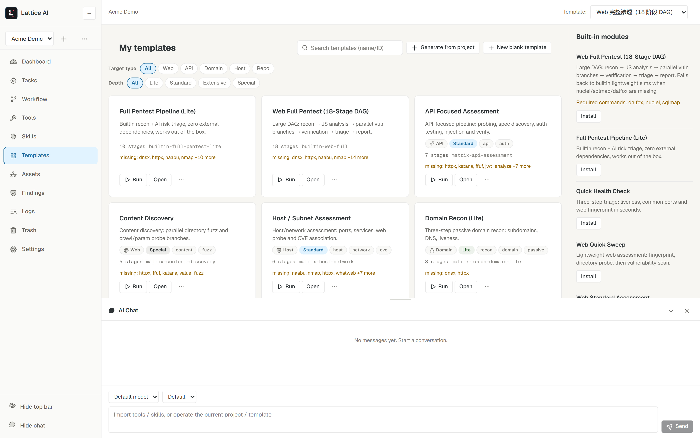
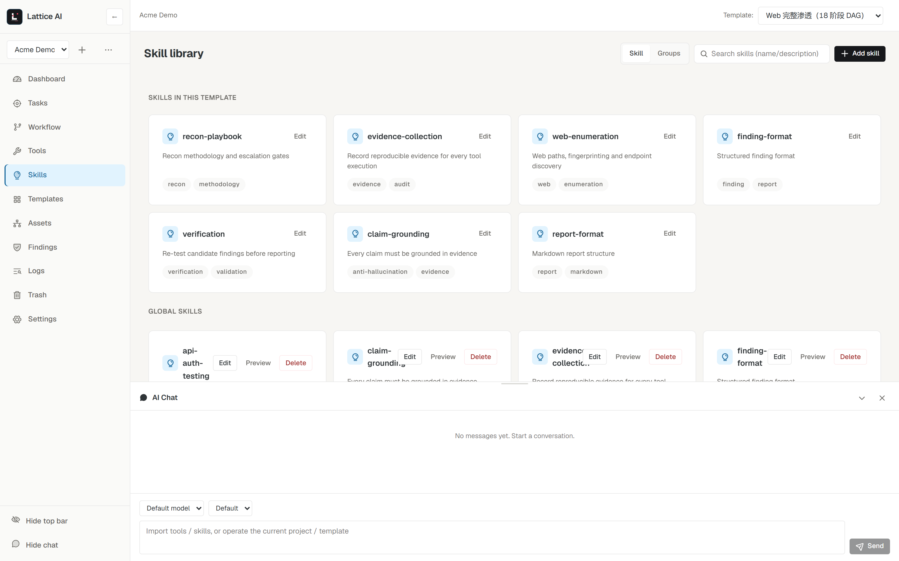
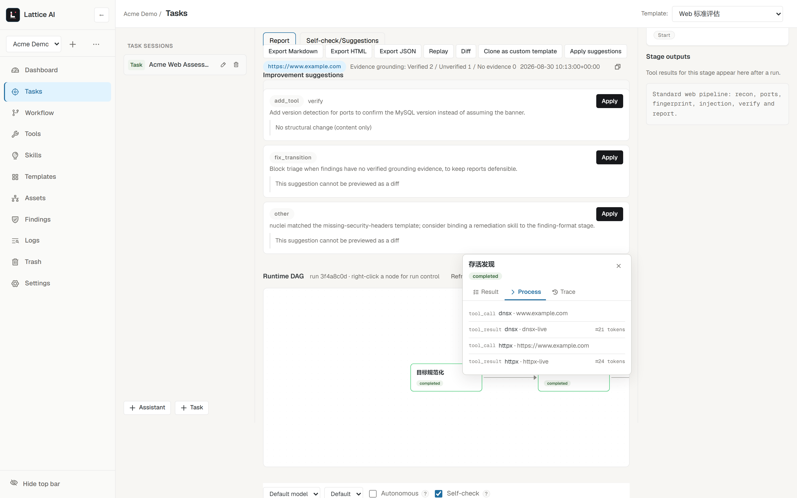
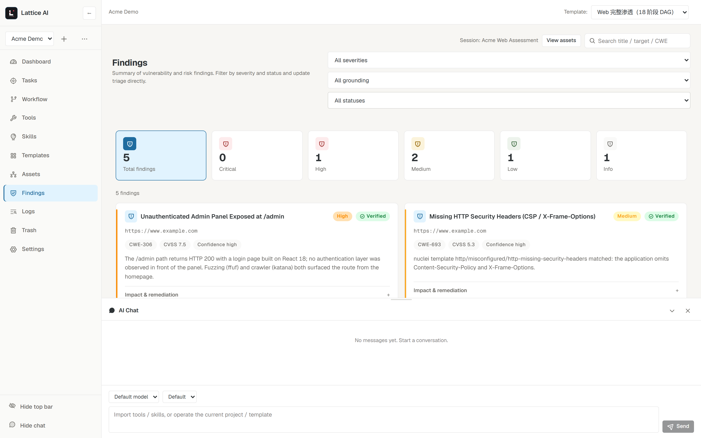
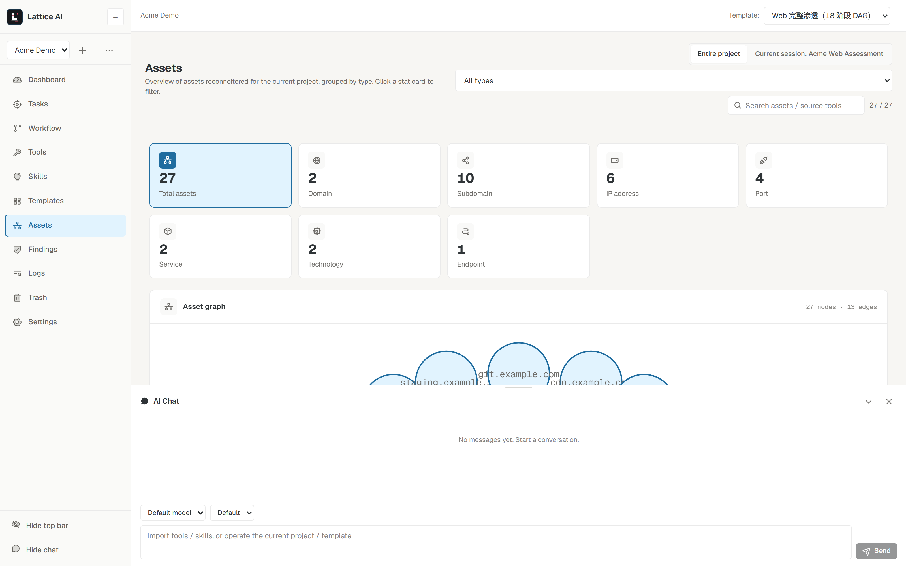
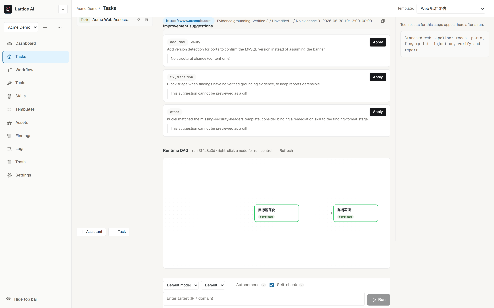

<p align="center">
  
</p>

<h1 align="center">Lattice AI</h1>

<p align="center">
  <em>Turn authorized security testing into a visual, deterministic, fully auditable workflow — powered by AI where it counts.</em>
</p>

<p align="center">
  <a href="README.md">English</a> · <a href="README.zh-CN.md">简体中文</a>
</p>

<p align="center">
  
  
  
  
  
  
</p>

---

**Lattice AI** is a local, single-user **AI-assisted security testing workflow engine** for authorized testing. It replaces the one-shot "black-box AI pentest agent" with something you can actually defend in a report:

> **visual orchestration → deterministic execution → AI enhancement → evidence-proof, replayable results.**

Every stage, tool, skill, transition and gate is a visible, editable object. Runs produce append-only event logs you can replay and audit. Findings carry evidence hashes and AI conclusions are checked against the raw evidence before they are recorded.

**Authorized use only.** Lattice AI can execute real security tools against real targets. Use it only on systems you own or have explicit written permission to test. The engine ships no weaponized exploit, C2 or lateral-movement primitives — the framework is tool-agnostic and never imposes its own attack capabilities.



---

## Why Lattice AI

| | Black-box AI pentest agents | Generic automation (n8n/Dify-style) | **Lattice AI** |
|---|---|---|---|
| Workflow visibility | ❌ hidden, one-shot | ✅ visual | ✅ **visual + security semantics** |
| Reproducibility | ❌ low | ✅ high | ✅ **deterministic replay, versioned templates** |
| Evidence chain | ❌ weak | ➖ generic | ✅ **evidence hashes + grounding verification** |
| Guardrails (scope / approval / redaction) | ➖ partial | ❌ none | ✅ **built-in, per-tool** |
| Security deliverables (findings / report) | ➖ ad-hoc | ❌ no | ✅ **structured findings + exportable reports** |
| Runs locally, data stays local | ➖ often cloud | ✅ | ✅ **self-hosted, single-user, offline-friendly** |

## Highlights

- **Visual workflow orchestration** — drag-stage DAG designer (React Flow) with conditional transitions, parallel branches, loops over facts and per-stage tool/skill/gate bindings. You design the methodology; the AI runs it.

  

- **Dual-mode engine with deterministic default** — *Controlled mode* executes the graph exactly as designed (reproducible, audit-friendly); *Autonomous mode* lets the LLM propose tool calls inside a stage, with approvals and framework-validated changes. Dead-loop protection, checkpoints and run-resume included.

- **Real tools when installed, simulators when not** — 14 real CLIs (subfinder, httpx, naabu, nmap, dnsx, tlsx, katana, gau, waybackurls, ffuf, nuclei, dalfox, sqlmap, trivy) are available from a registry with pinned, one-click installs and version checks. Missing tools automatically fall back to builtin **simulators with an identical JSON output schema**, so templates behave the same in both tiers — and the run header shows exactly what ran (`real 8 / sim 3`).

  

- **Natural-language & paste-to-tool import** — paste a command, script, MCP server URL or GitHub link — or just ask the AI chat ("import a tool that enumerates subdomains") — and a five-step wizard (parse → inspect → preview → trial run with your sample output → store) turns it into an orchestratable tool card with declared params, output schema, secrets and approval level, then binds it to a template. The same natural-language path generates whole templates from a URL or a one-sentence description of your methodology.

  

- **Template matrix + marketplace** — 10 built-in templates organized by **target type × depth** (Web / API / Domain / Host / Repo × Lite / Standard / Extensive / Special), each a real methodology DAG you can clone, edit, version (lineage + rollback) and share as a template package.

  

- **Skill system** — SKILL.md-style skills bound to stages instruct the agent (recon playbooks, evidence rules, claim-grounding, report formats…). The nuclei-templates knowledge base can be imported as classification-tagged skills.

  

- **Run-time observability** — per-stage execution telemetry (elapsed, tool calls, token usage), a node run drawer with *Result / Process / Trace* tabs, event-stream ↔ canvas linkage, and a live progress bar. Everything is an **append-only event log**.

  

- **Evidence-proof findings** — every tool result is archived with a content hash; findings carry severity/CWE/CVSS/repro steps and **grounding verdicts** — AI conclusions are verified against raw evidence text (*Verified / Unverified / Missing evidence*) and the run report shows the verification stats.

  

- **Asset intelligence** — discovered domains, subdomains, IPs, ports, services, technologies and endpoints are deduplicated into a typed asset store with an interactive relation graph, and flow into dashboard KPIs.

  

- **Self-evolution loop** — after every run the engine reviews its own execution and produces concrete workflow-improvement suggestions; preview them as a diff, apply with one click (a version snapshot is created automatically), and roll back any time — n8n-style version lineage. The suggestion feed is per-run, so you can watch your methodology evolve run over run.

  

- **Governance built in** — scope policy (allow domains/IPs/CIDRs/ports/URL prefixes + restricted-target rejection at preflight), per-tool approval policy (allow / ask / deny, high-risk defaults to ask), danger levels, and `secret_fields` redaction applied before anything is persisted.

- **Local-first, single-user** — FastAPI + React app served from one origin (`127.0.0.1:8742`), SQLite (WAL) per project, human-readable JSON/YAML configs, LAN access with a bearer token, light/dark theme and a bilingual (English / 简体中文) UI. No cloud, no accounts, no telemetry.

- **Bring your own LLM** — OpenAI-compatible provider abstraction (OpenAI / DeepSeek / local vLLM or Ollama gateways), used for stage reasoning, tool proposals, natural-language import, template generation and the AI chat dock.

## Quick start

Requirements: **Python ≥ 3.10**; Node.js only if you need to build the web UI (the prebuilt output ships inside the package).

### 1. Get the code

```bash
git clone https://github.com/pyconly/Lattice-AI.git lattice-ai   # or: Code → Download ZIP
cd lattice-ai
```

### 2. Install

```powershell
pip install -e .
```

Installs the engine runtime (`jsonschema`, `pyyaml`) and the local server stack (`fastapi`, `uvicorn`, `httpx`), plus the `lattice-ai` command-line entry. Add `[dev]` if you want pytest: `pip install -e ".[dev]"`.

### 3. Build the web UI (one time, from a source checkout)

```powershell
cd web
npm install
npm run build
cd ..
```

### 4. Launch

```powershell
python scripts/lattice_launcher.py     # desktop launcher: starts, health-checks, opens the browser
# or:
lattice-ai serve                        # same thing via the installed CLI (--host/--port/--no-browser)
```

`Ctrl+C` (or closing the window) stops the service; if a service is already running it just opens the UI. Recreate the desktop shortcut later with `scripts/create_desktop_shortcut.ps1`.

**Prefer the development mode?** Backend: `python -m uvicorn lattice_ai.server:app --host 127.0.0.1 --port 8742` · Frontend with hot reload: `cd web && npm run dev` → open http://127.0.0.1:6317. First configure an LLM in **Settings**, then run the built-in `example.com` demo entry from the dashboard.

## Getting started in 60 seconds

1. Open the dashboard and pick a template — e.g. **quick triage** (`liveness → common ports → fingerprint`), which returns results in ~30 seconds.
2. Open the timeline to see every stage/tool call — nothing is hidden.
3. Go to **Findings**: AI-generated findings are listed with evidence links and grounding badges.
4. Open **Tools** and one-click install the registry (subfinder/httpx/nuclei/nmap…); re-run and watch the run header flip to `real`.

## Data & storage

- **Small, human-editable configs** (templates, tools, skills, settings, policies) live as JSON/YAML — inspect or hand-edit them any time.
- **High-volume run data** (runs, evidence, findings, approvals, stage executions) lives in `data/projects/<project>/project.db` (SQLite, WAL mode): atomic, transactional, concurrent-safe, no full reload at startup.
- **Data directory resolution**: source checkouts use the repo-local `data/`; installed packages (`pip install lattice-ai`) use `~/.lattice-ai`. Override with the `LATTICE_DATA_DIR` environment variable.
- Legacy per-file `sessions/`, `evidence/`, `findings/` are **migrated once, non-destructively** on first start; originals stay as a fallback.

## Security & remote access

- The backend listens on `127.0.0.1` by default. For LAN access bind `0.0.0.0` and clients must send a bearer token (`Authorization: Bearer <token>` / `X-Lattice-Token`); loopback requests are exempt. Token is generated on first start (`data/auth_token.json`, override with `LATTICE_TOKEN`).
- Browser-origin checks (Origin/Referer/Sec-Fetch) block cross-site requests and DNS rebinding; `LATTICE_ALLOWED_HOSTS` for other hostnames.
- CLI sandbox = timeout + output truncation + `cwd` restraint + `Tool.scope` checks — not OS-level isolation. Never run untrusted scripts in it.

## Known boundaries

- Builtin simulators are standard-library approximations — same JSON schema as the real tools, not equivalent results. With real CLIs installed, runs switch to the real tier automatically.
- Real CLIs need Go (most ProjectDiscovery tools) or per-registry installs (e.g. nmap + Npcap); missing tools fall back to simulators, runs never break.
- Security boundaries are process-level, not container-level (Docker Job Object isolation is on the roadmap).
- Single-user by design: no accounts, no multi-user collaboration.

## License & thanks

- **Lattice AI engine, built-in templates and skills: [Apache-2.0](LICENSE)** — permissive with an explicit patent grant, so enterprise security teams can adopt it without license friction.
- Third-party tools keep their own licenses and are **invoked as external CLIs, never copied or modified**: ProjectDiscovery tools (subfinder/httpx/naabu/nuclei/katana/ffuf/dnsx/tlsx/dalfox, MIT), [nmap](https://nmap.org) (GPL-2.0+ with special exceptions; see nmap.org), [sqlmap](https://github.com/sqlmapproject/sqlmap) (GPL-2.0+), [trivy](https://github.com/aquasecurity/trivy) (Apache-2.0). UI/runtime dependencies: [React Flow](https://reactflow.dev) (MIT), [FastAPI](https://fastapi.tiangolo.com) (MIT).
- Methodology/design ideas cross-pollinated from OSS: workflow classification (Osmedeus), template-marketplace semantics (nuclei), version-lineage restore (n8n), severity palette & dashboards (reNgine).

---

<p align="center">
  <sub>Only test systems you are authorized to test. Lattice AI is a framework, not a payload. 🛡️</sub>
</p>
