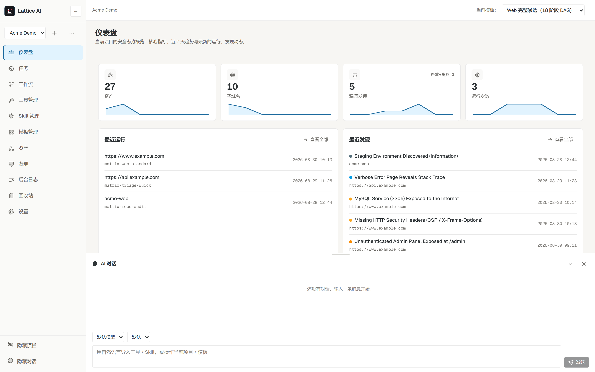
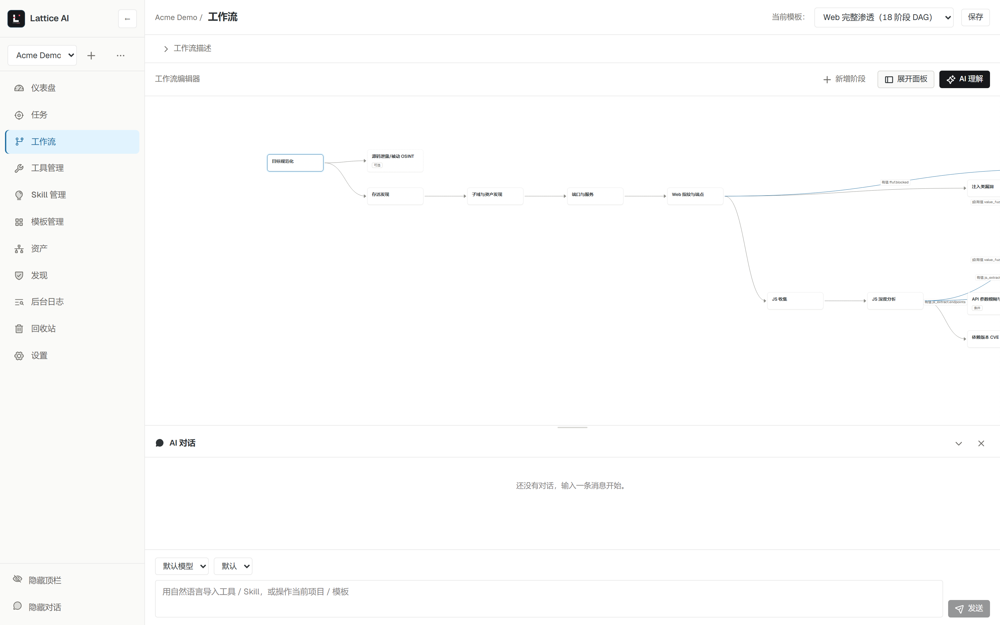
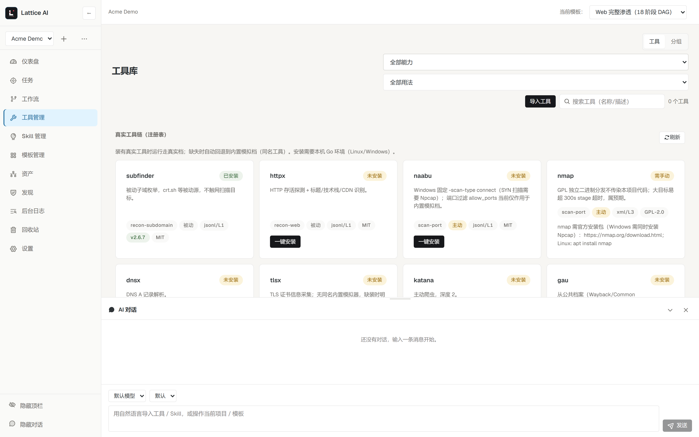
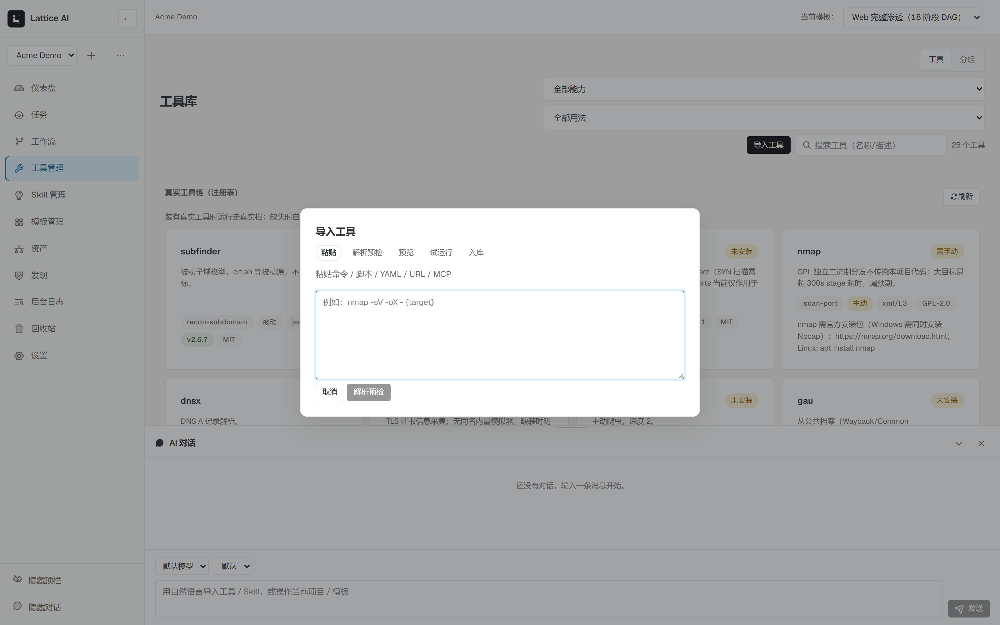
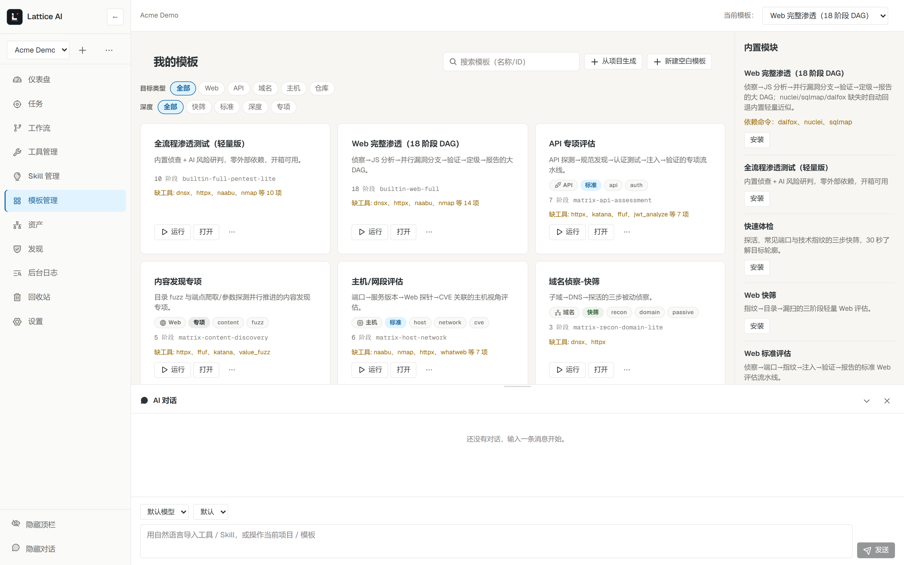
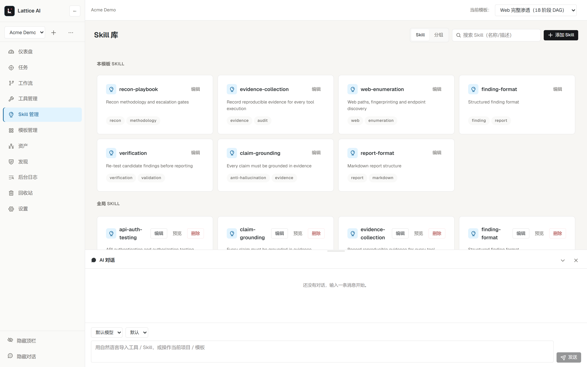
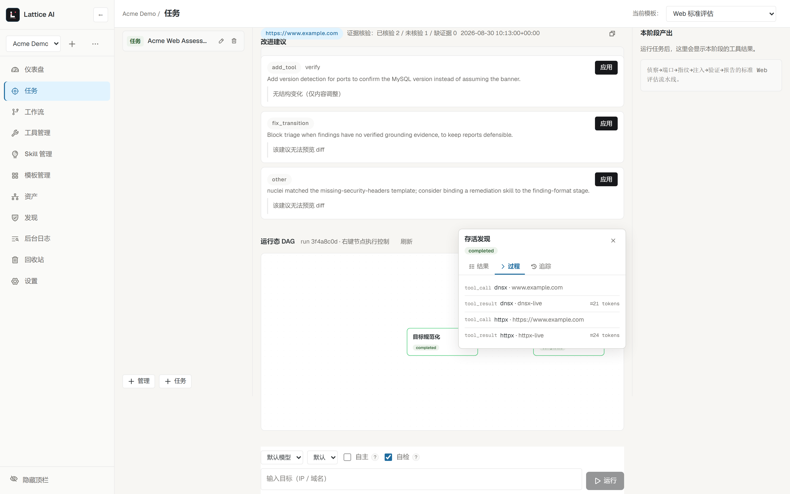
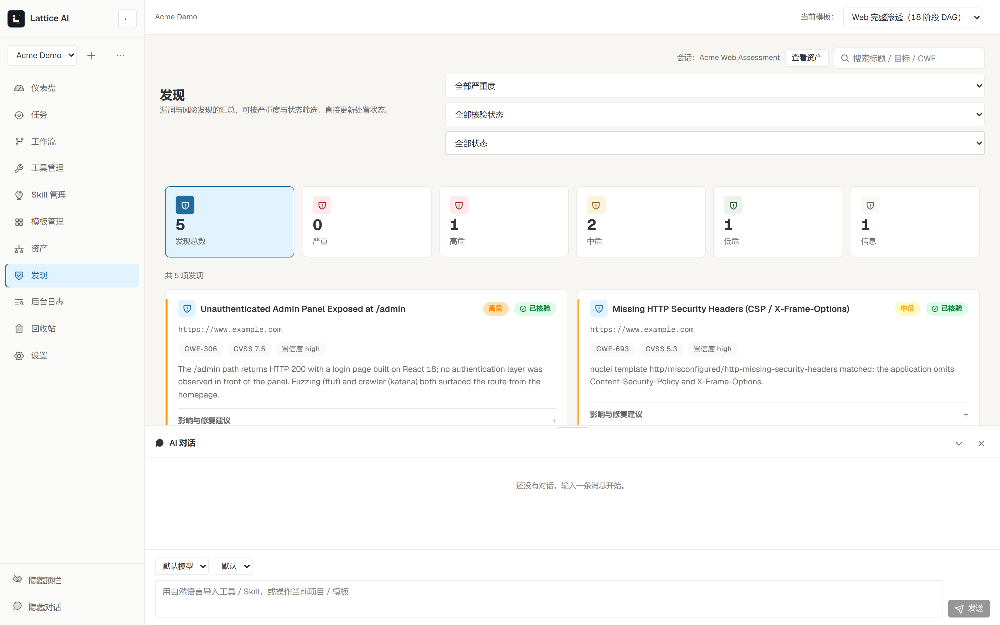
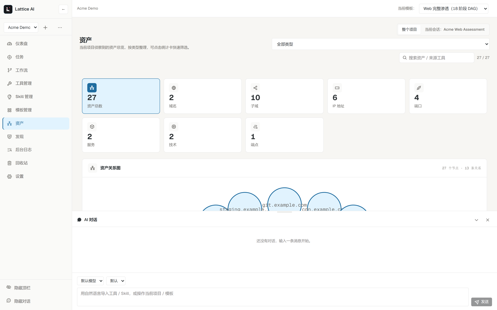
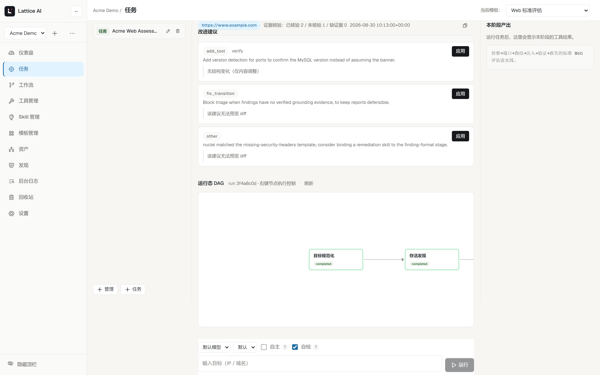

<p align="center">
  
</p>

<h1 align="center">Lattice AI（攻阵）</h1>

<p align="center">
  <em>把授权安全测试，变成可视化、确定性、全程可审计的工作流 —— 在关键的环节让 AI 发挥价值。</em>
</p>

<p align="center">
  <a href="README.md">English</a> · <a href="README.zh-CN.md">简体中文</a>
</p>

<p align="center">
  
  
  
  
  
  
</p>

---

**Lattice AI** 是一个单机、单用户的 **AI 辅助安全工作流引擎**，面向授权测试场景。它把「黑盒 AI 渗透 Agent 的一次性运行」变成可以在报告里站得住脚的东西：

> **可视化编排 → 确定性执行 → AI 增强 → 有证据、可回放、可交付的结果。**

每个阶段、工具、Skill、转移和门控都是一等公民：看得见、能编辑、可复用。运行产生 append-only 事件日志，可回放、可审计；发现（Finding）关联证据哈希存档，AI 结论先经过证据回溯（grounding）校验再落库。

**仅限授权测试。** Lattice AI 可以调用真实安全工具对真实目标执行动作。请只在你有权测试（自有系统或已获明确书面授权）的目标上使用。引擎不内置武器化 exploit、C2 或横向移动原语——框架与工具无关，不替用户提供攻击能力。



---

## 为什么选择 Lattice AI

| | 黑盒 AI 渗透工具 | 通用自动化（n8n/Dify 类） | **Lattice AI** |
|---|---|---|---|
| 工作流可见性 | ❌ 隐藏、一次性 | ✅ 可视化 | ✅ **可视化 + 安全语义** |
| 可复现性 | ❌ 弱 | ✅ 高 | ✅ **确定性回放 + 模板版本化** |
| 证据链 | ❌ 薄弱 | ➖ 通用日志 | ✅ **证据哈希 + 结论核验（grounding）** |
| 安全护栏（范围/审批/脱敏） | ➖ 部分 | ❌ 无 | ✅ **内置，逐工具治理** |
| 安全交付物（发现/报告） | ➖ 临时拼凑 | ❌ 无 | ✅ **结构化发现 + 可导出报告** |
| 本地运行、数据不出内网 | ➖ 常依赖云端 | ✅ | ✅ **自托管、单用户、离线可用** |

## 核心能力

- **可视化工作流编排** —— 基于 React Flow 的阶段图设计器：条件转移、并行分支、基于 facts 的循环、每阶段的工具/Skill/门控绑定。方法论由你设计，AI 负责执行。

  

- **双模式引擎，确定性为默认** —— *受控模式*严格按图执行（可复现、可审计）；*自主模式*允许 LLM 在阶段内提议工具调用，经审批钩子与框架校验后生效。内置死循环防护、检查点（checkpoint）与续跑。

- **装了真工具用真工具，没装用内置模拟** —— 工具注册表收录 14 个真实 CLI（subfinder、httpx、naabu、nmap、dnsx、tlsx、katana、gau、waybackurls、ffuf、nuclei、dalfox、sqlmap、trivy），支持锁版本一键安装与版本探测；缺失时自动回退**输出 schema 完全同构的内置模拟器**，模板在两档下行为一致——运行头实时显示「真实 8 / 模拟 3」的实际档位。

  

- **自然语言 + 粘贴即导入** —— 粘贴一条命令 / 脚本 / MCP 地址 / GitHub 链接，或者在 AI 对话里直接用一句话说「帮我导入一个枚举子域名的工具」，五步向导（解析预检 → 预览补缺 → 试运行（用你的真实样例输出）→ 入库 → 绑定模板）将其变成可编排的工具卡，并自动带上参数、输出 schema、脱敏字段与审批级别。同一条自然语言通道还能根据 URL 或一句话方法论描述**直接生成完整模板**。

  

- **模板矩阵 + 市场** —— 10 个内置模板按 **目标类型 × 深度档位**（Web / API / 域名 / 主机网段 / 仓库 × 快筛 / 标准 / 深度 / 专项）组织；每个都是真实的方法论 DAG，可克隆、编辑、版本化（血缘 + 回滚），并以模板包分享。

  

- **Skill 体系** —— 以 SKILL.md 约定挂载到阶段的技能（侦察手册、证据规则、claim-grounding、报告规范…）指导 Agent 行为；nuclei-templates 检测知识库可一键导入为带分类字段的 Skill。

  

- **运行可观测** —— 阶段级执行记录（耗时 / 工具次数 / token 用量）、节点运行抽屉（结果 / 过程 / 追踪三 Tab）、事件流与画布联动、悬浮运行条。一切尽在 **append-only 事件日志**。

  

- **证据可证明的发现** —— 每次工具结果按内容哈希归档；发现携带严重级 / CWE / CVSS / 复现步骤与 **grounding 核验状态**（已核验 / 未核验 / 缺证据），AI 结论须经原始证据文本校验，报告头展示核验统计。

  

- **资产情报** —— 域名、子域名、IP、端口、服务、技术与端点自动去重入库，形成带类型的资产关系图，并汇入仪表盘 KPI。

  

- **自进化回路** —— 每次运行结束后，引擎会复盘自身执行并产出具体的工作流改进建议：diff 预览 → 一键应用（自动创建版本快照）→ 随时回滚，n8n 式版本血缘；建议列表按运行归档，你可以看到方法论一次比一次演进。

  

- **安全治理内建** —— 范围策略（域名 / IP / 网段 / 端口 / URL 前缀白名单 + 受限目标预检拦截）、逐工具审批策略（放行 / 询问 / 拒绝，高危默认询问）、危险等级、`secret_fields` 落库前的脱敏。

- **本地优先、单用户** —— FastAPI + React 同源托管（单端口 `127.0.0.1:8742`），每个项目独立 SQLite（WAL）；模板 / 工具 / Skill / 设置均为可读可改的 JSON/YAML；局域网访问需携带令牌；明/暗主题 + 中英双语界面。无云、无账号、无遥测。

- **自带 LLM** —— OpenAI 兼容 Provider 抽象（OpenAI / DeepSeek / 本地 vLLM、Ollama 网关），用于阶段推理、工具提议、自然语言导入、模板生成与 AI 对话侧栏。

## 快速开始

前置要求：**Python ≥ 3.10**；仅当你需要重新构建前端时才需要 Node.js（包内已附带预构建产物）。

### 1. 获取代码

```bash
git clone <本仓库地址> lattice-ai   # 或：Code → Download ZIP
cd lattice-ai
```

### 2. 安装

```powershell
pip install -e .
```

安装引擎运行时（`jsonschema`、`pyyaml`）与本地服务端（`fastapi`、`uvicorn`、`httpx`），同时提供 `lattice-ai` 命令行入口。需要跑测试时加 `[dev]`：`pip install -e ".[dev]"`。

### 3. 构建 Web 前端（源码运行需一次）

```powershell
cd web
npm install
npm run build
cd ..
```

### 4. 启动

```powershell
python scripts/lattice_launcher.py     # 桌面启动器：启动服务 → 健康检查 → 自动打开浏览器
# 或：
lattice-ai serve                        # 安装版 CLI 同款入口（--host/--port/--no-browser）
```

`Ctrl+C` 或关窗即停止服务；若服务已在运行则只打开界面。快捷方式可用 `scripts/create_desktop_shortcut.ps1` 重新生成。

**想用开发模式？** 后端：`python -m uvicorn lattice_ai.server:app --host 127.0.0.1 --port 8742`；前端：`cd web && npm run dev` → 打开 http://127.0.0.1:6317（热更新）。先在「设置」里配置 LLM，然后可用首页的 `example.com` 示例入口一键运行。

## 一分钟上手

1. 打开仪表盘，选一个模板——比如 **快速体检**（探活 → 常见端口 → 技术指纹），约 30 秒出结果。
2. 展开时间线：每个阶段、每次工具调用都记录在案，没有黑箱。
3. 到「发现」页：AI 生成的漏洞均有证据关联与核验徽标。
4. 到「工具管理」一键安装注册表（subfinder / httpx / nuclei / nmap…），重跑一次，观察运行头切到「真实档」。

## 数据存储

- **小体量配置**（模板 / 工具 / Skill / 设置 / 策略）为 JSON/YAML 文件，可直接查看与手工编辑。
- **高体量运行数据**（运行记录、证据、发现、审批、阶段执行）在 `data/projects/<项目>/project.db`（SQLite，WAL 模式）：写入原子、事务化，支持并发运行，启动不整体载入内存。
- **数据目录解析**：源码运行使用仓库内 `data/`；安装包（`pip install lattice-ai`）使用 `~/.lattice-ai`。可用 `LATTICE_DATA_DIR` 环境变量覆盖。
- 旧版按文件存放的 `sessions/`、`evidence/`、`findings/` 会在首次启动时**一次性、非破坏性**导入；原文件保留作为回退。

## 安全与远程访问

- 后端默认只监听 `127.0.0.1`。局域网访问时改绑 `0.0.0.0`，远程客户端必须携带令牌（`Authorization: Bearer <token>` / `X-Lattice-Token`；回环请求免令牌）。令牌首次启动生成于 `data/auth_token.json`，可用 `LATTICE_TOKEN` 覆盖。
- API 对带浏览器标记（Origin / Referer / Sec-Fetch）的请求做来源校验，防跨站与 DNS rebinding；`LATTICE_ALLOWED_HOSTS` 放行其它主机名。
- CLI 沙箱边界 = 超时 + 输出截断 + `cwd` 限制 + `Tool.scope` 校验，不是操作系统级隔离。不可信脚本不应直接运行。

## 已知边界

- 内置模拟器是标准库实现的功能近似：与真实工具输出 schema 同构，但结果不等价。安装真实 CLI 后运行自动走真实档。
- 真实 CLI 需要本机 Go（多数为 ProjectDiscovery 系）或按注册表提示安装（如 nmap + Npcap）；缺失时自动回退模拟档，运行不中断。
- 安全边界是进程级而非容器级（Docker Job Object 隔离在路线图上）。
- 定位为单用户：无账号体系、不做多人在线协作。

## 许可证与致谢

- **Lattice AI 引擎、内置模板与 Skill：[Apache-2.0](LICENSE)** —— 宽松许可并附带明确的专利授权条款，企业安全团队采用无许可摩擦。
- 第三方工具保留各自许可，且仅作为**外部 CLI 调用，不复制、不修改**：ProjectDiscovery 工具族（subfinder/httpx/naabu/nuclei/katana/ffuf/dnsx/tlsx/dalfox，MIT）、[nmap](https://nmap.org)（GPL-2.0+，含特殊例外条款，见 nmap.org）、[sqlmap](https://github.com/sqlmapproject/sqlmap)（GPL-2.0+）、[trivy](https://github.com/aquasecurity/trivy)（Apache-2.0）。界面与运行时依赖：[React Flow](https://reactflow.dev)（MIT）、[FastAPI](https://fastapi.tiangolo.com)（MIT）。
- 方法论与产品形态参考了开源社区：模板分类（Osmedeus）、模板市场语义（nuclei）、版本血缘恢复（n8n）、严重级配色与仪表盘（reNgine）。

---

<p align="center">
  <sub>请只对你有权测试的目标进行测试。Lattice AI 是框架，不是武器。🛡️</sub>
</p>
